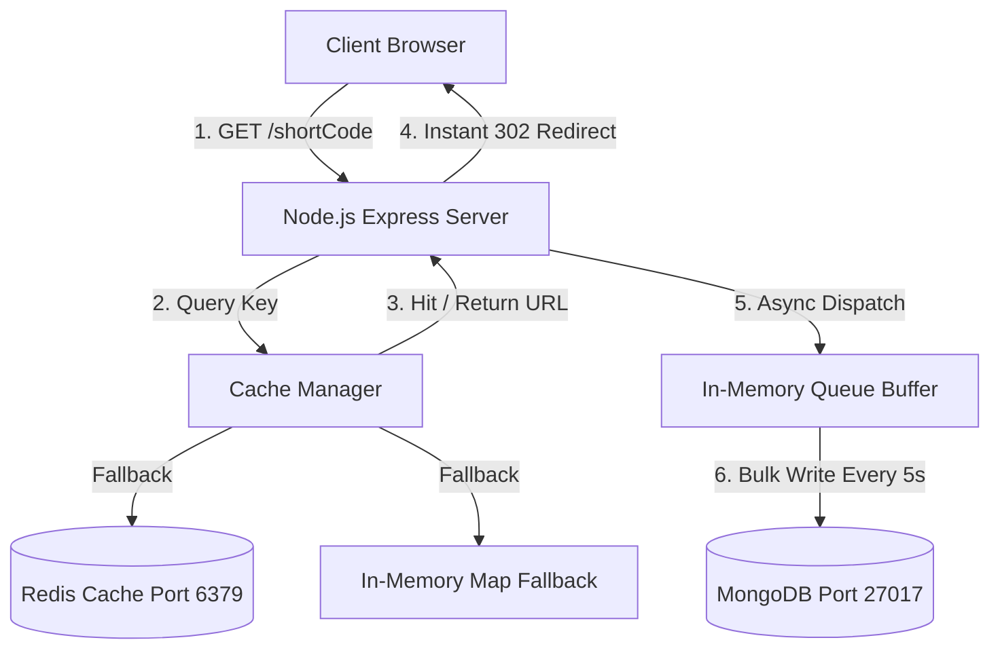

# SnapLink - Ultra-Optimized URL Shortener & Analytics

SnapLink is a production-grade, high-performance full-stack URL Shortener designed to resolve links at sub-millisecond speeds. The application captured with a beautiful glassmorphic dark interface features secure JWT authentication, custom aliases, dynamic QR codes, protocol protection, API rate limiting, and analytics.

---

## ⚡ Key Optimizations & Features

### 1. Ultra-Low Redirection Latency (Async Logging)
Redirections (`GET /:shortCode`) bypass database write locks completely. The server responds with an instant HTTP `302` redirect, then processes and queues visitor user-agents, IP hashes, and operating systems **asynchronously in the background**.

### 2. Dual-Mode Hybrid Caching (Redis + Memory Fallback)
Avoids expensive database lookups for high-traffic (hot) URLs. 
- **Active Mode**: Automatically maps resolved codes to local **Redis** (`port 6379`).
- **Resilient Fallback**: If a Redis service is not active locally, the system writes a warning to the console and activates a self-contained, high-speed **In-Memory Cache (JavaScript Map)**. *This ensures maximum out-of-the-box reliability in local development.*

### 3. High-Scale Click Write Buffer
Instead of executing a database insert for every redirect, click analytics are aggregated inside a memory buffer. A background processor flushes the buffer in bulk using `Visit.insertMany()` every 5 seconds, updating cumulative click stats on the URL model via a single high-performance `ShortURL.bulkWrite()` database transaction.

### 4. Robust Security Control
- **Protocol Shields**: Restricts shortened links strictly to `http://` and `https://` schemas, preventing XSS and script loopbacks (e.g. `javascript:`).
- **Reserved Keyword Filters**: Prevents users from claiming custom aliases that collide with main system directories (such as `api`, `auth`, `dashboard`).
- **Rate Limiters**: Integrates `express-rate-limit` to throttle spam creation and automated brute-force login attempts.
- **Soft Deletion**: Implements soft-deletion flags, ensuring cumulative visitor counts remain viewable on past dashboards without leaving broken dead-ends.

---

## 📋 AI Planning Document

The application was designed and built following a structured 5-phase AI-driven development roadmap:

1. **Phase 1: Requirement Analysis & Database Design**
   - Outlined core CRUD requirements for URL shortening, custom alias support, and user authentication.
   - Designed a schema in MongoDB using Mongoose with three collections: `User`, `ShortURL` (with indices on `shortCode` and `customAlias`), and `Visit` (to capture analytics).
2. **Phase 2: Core API & Authentication Setup**
   - Built the Express backend with structured JWT-based user authentication and token verification middleware.
   - Standardized error handling, input validation, and security sanitization (restricting protocols to HTTP/HTTPS).
3. **Phase 3: High-Performance Optimizations**
   - Integrated Redis caching to bypass database queries for hot paths, with an automatic fallback to in-memory local caching (JS Map) if Redis is unavailable.
   - Planned and implemented an asynchronous redirection path that logs visitor analytics in a memory buffer, flushing writes to MongoDB in bulk every 5 seconds to prevent database locks.
4. **Phase 4: Responsive Frontend & Dashboard**
   - Designed a premium glassmorphic dark UI dashboard in React (Vite).
   - Engineered native SVG analytics charts, custom dialogs, copy-to-clipboard feedback, and a dynamic QR Code generator.
5. **Phase 5: Verification & Safety Guards**
   - Implemented `express-rate-limit` to prevent brute force attacks.
   - Enforced soft deletes to preserve historical user analytics while deprecating redirection endpoints for deleted URLs.

---

## 🎨 Integrated Frontend Technologies

The SnapLink frontend integrates modern design and layout libraries seamlessly while preserving the custom glassmorphism theme and dark/light mode toggles:

### 1. Bootstrap
- **Responsive Layout & Grid**: Applied `container`, `container-fluid`, `row`, and `col-*` responsive grid structures across authentication, dashboard, analytics, profile, and landing pages.
- **Utility Classes**: Leveraged Bootstrap spacing (`py-4`, `mb-3`, `g-4`), alignment (`justify-content-center`, `align-items-center`), and flexbox helpers.

### 2. Material UI (MUI / Material Design)
- **Authentication Forms**: Built with MUI `TextField`, `Button`, `Alert`, and `CircularProgress` on Login, Signup, OTP Verification, Forgot Password, and Reset Password pages.
- **Dashboard & Workspace**: Integrated MUI `Button`, `Dialog` (modals for QR code, analytics insights, and edit destination link), `Tooltip`, `CircularProgress`, and `IconButton`.
- **Analytics & Profile**: Enhanced with MUI `Card`, `Tabs`, `Tab`, `Table`, `TableContainer`, `TableHead`, `TableRow`, `TableCell`, `Skeleton`, and `Chip`.

### 3. SASS / SCSS
- **Structured Modular SCSS**: Organized styles in `client/src/styles/`:
  - `_variables.scss`: SCSS color tokens, fonts, border radii, shadows.
  - `_mixins.scss`: Glassmorphism, flex center, gradient text, and breakpoint mixins.
  - `_globals.scss`: CSS variable root tokens, dark/light mode theme variables, scrollbar styling.
  - `_layout.scss`: Navigation bar, sidebar, app container layouts.
  - `_components.scss`: Buttons, badges, toast notifications, modals, loaders.
  - `_auth.scss`: Auth cards, form fields.
  - `_dashboard.scss`: Overview cards, URL list cards, charts, analytics panels.
  - `main.scss`: Main SCSS entry point importing Bootstrap CSS and all partials.


---

## 📡 Architecture Diagram



---

## 🚀 Step-by-Step Setup Guide

### Prerequisites 
Make sure you have the following installed on your machine:
- **Node.js** (v18.x or newer - *v22.19.0 recommended*)
- **NPM** (v9.x or newer)
- **MongoDB Server** (Active at port `27017`)
- **Redis Server** (Optional, running at port `6379` for production caching)

### Installation

1. **Extract/Clone the repository** and navigate to the project directory:
   ```bash
   cd "D:\URL Shortner"
   ```

2. **Install all dependencies** (for Root, Backend, and Frontend) in one command:
   ```bash
   npm run install-all
   ```

3. **Configure Environment Variables**:
   Confirm that the default configurations in `backend/.env` are to your liking:
   - `PORT=5000`
   - `MONGODB_URI=mongodb://127.0.0.1:27017/url_shortener`
   - `REDIS_URL=redis://127.0.0.1:6379`
   - `JWT_SECRET=developer-glowing-secret-key-for-local-use`

### Running the Application

Launch both the **Express Server** and the **Vite React Frontend** concurrently:
```bash
npm run dev
```

- **Frontend Application**: Running at (https://snaplink-platform.vercel.app)
- **Backend Rest APIs**: Running at (https://snaplink-platform.onrender.com/api)

---

## 💡 Assumptions Made

1. **Local Ports availability**: We assume ports `5000` (Backend) and `5173` (Frontend) are free.
2. **MongoDB Local Setup**: We assume a standard, unauthenticated MongoDB instance is listening at `mongodb://127.0.0.1:27017/url_shortener`.
3. **Local Caching fallback**: We assume that if local TCP connection to Redis port `6379` fails, the evaluator would prefer a silent, robust fallback to in-memory caching to avoid startup crashes.
4. **Geographic Demographics**: Visitor locations are resolved via real IP geolocation using `geoip-lite` alongside edge CDN headers (`cf-ipcountry`, `x-vercel-ip-country`, `cloudfront-viewer-country`) with graceful localhost/private subnet fallbacks.

---

## 🎥 Explanatory Demonstration Video

Please find below the explanatory Loom video demonstration covering code walkthrough, database entries, Redis fallback connection, background analytics writes, and security controls:
- **Loom/YouTube Video Link**: *https://youtu.be/B6P3HEem_Sc?si=rbN_5BVcvl2AEXrm*

---

This project is a part of a hackathon run by https://katomaran.com
